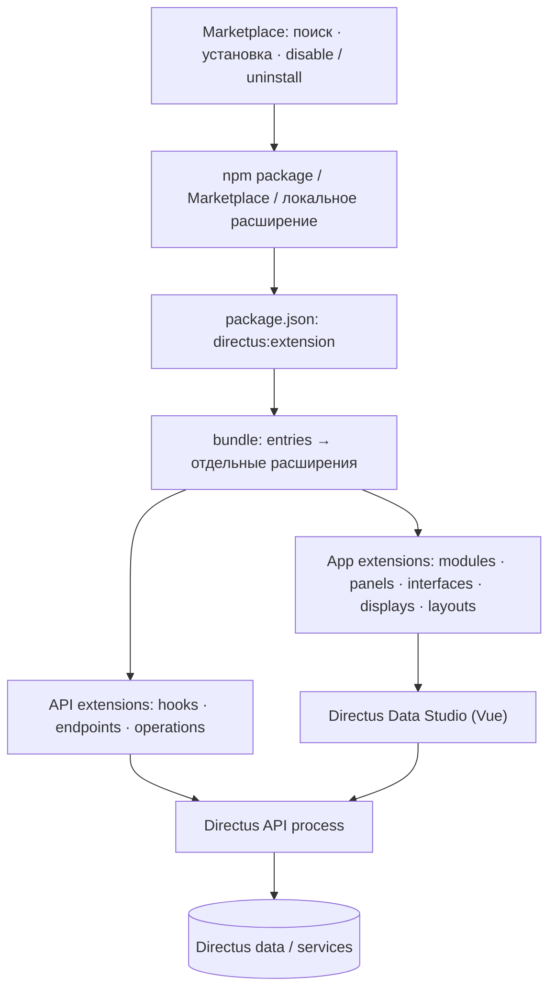

# Directus: архитектура расширений и bundles

**Статус:** исследовательская заметка для проекта Hyper, не спецификация Directus и не предложение перенести его API дословно. Проверено по официальной документации Directus (ссылки в конце каждого раздела). Сравнительный обзор: [10 систем плагинов](plugin-systems-comparison.md); наша архитектура: [принципы расширяемости](plugin-extension-principles.md).

## 1. Модель в одном рисунке



**Важное разграничение:** bundle — *способ упаковать и доставить* несколько расширений; entry — *конкретный вклад* определённого типа. У разных типов разные точки загрузки и разные API. Это близко к замыслу Hyper: bundle содержит несколько плагинов, каждый приносит реализации `$<keyword>_<name>.*`. Но Directus не предоставляет ту же произвольную файловую грамматику и возможность добавить новый тип загрузчика простым `$loader_`-файлом.

Источники: [Overview](https://directus.io/docs/guides/extensions/overview), [Bundles](https://directus.io/docs/guides/extensions/bundles).

## 2. Кто за что отвечает

| Уровень | Назначение | Примеры |
|---|---|---|
| Дистрибутив | npm-пакет расширения или bundle; метаданные в `package.json` | зависимости, сборка, перечень `entries` |
| Extension type | Контракт между исполняющей средой и реализацией | hook, endpoint, module, panel, operation |
| Backend runtime | Выполняет серверный JS/TS-код расширения | события и HTTP, операции Flow |
| Data Studio | Загружает UI-компоненты расширений | навигация, формы, панели |
| Marketplace / registry | Поиск, информация, установка и управление расширениями | совместимость, enable/disable, uninstall |

Разделение frontend/backend не формальность: например, **operation** для Flow имеет *два entrypoint* — визуальные настройки шага в Data Studio и обработчик на сервере. Нельзя описать её одной универсальной функцией без потери этого различия. [Flow Operations](https://directus.io/docs/guides/extensions/api-extensions/operations).

## 3. Типизированные вклады

### Server / API

- **Event hooks.** Entry-функция получает средства регистрации. `filter` вызывается до события и может проверять, менять или предотвращать действие; `action` реагирует после события. Есть и иные жизненные/плановые события. Поскольку код выполняется в процессе Directus, это не просто безопасное чтение декларации. [Event Hooks](https://directus.io/docs/guides/extensions/api-extensions/hooks).
- **Endpoints.** Entry-функция получает router и context; регистрирует HTTP-подмаршруты под URL расширения. Параметры маршрута могут быть заданы объектом конфигурации. [API Endpoints](https://directus.io/docs/guides/extensions/api-extensions/endpoints).
- **Flow operations.** Пользователь выбирает операцию в визуальном Flow и задаёт её параметры; серверный handler выполняет шаг. Это композиция UI-декларации с отдельной серверной логикой. [Flow Operations](https://directus.io/docs/guides/extensions/api-extensions/operations).
- **Доступ к сервисам.** Расширения могут использовать `ItemsService`, `FilesService` и другие внутренние сервисы через контекст. Правильное указание `accountability` важно: отсутствие контекста доступа может означать права администратора. Это полезный пример того, что хосту нужно явно задавать полномочия расширения. [Services](https://directus.io/docs/guides/extensions/api-extensions/services).

### App / UI

- **Modules** — верхнеуровневые области Data Studio с собственными маршрутами и навигацией; включаются в настройках проекта. [Custom Modules](https://directus.io/docs/guides/extensions/app-extensions/modules).
- **Panels** — компоненты дашборда. **Interfaces** — редакторы значений полей. **Displays** — способы показать значения. **Layouts** — представления коллекции. Каждый тип имеет свою форму конфигурации и контекст рендера; это не просто произвольный HTML по одному адресу. [App Extensions](https://directus.io/docs/guides/extensions/app-extensions), [Dashboard Panels](https://directus.io/docs/guides/extensions/app-extensions/panels).

**Параллель с Hyper:** `$route_` ближе к endpoint, `$app_` — к module, `$widget_` — к panel, `$canvas_` — к отдельному виду UI, `$hook_` — к event hook. Это аналогии для сравнения, не совпадающие контракты.

## 4. Устройство bundle

Документация Directus определяет bundle как **один распространяемый пакет для нескольких расширений**, в том числе для совместного использования зависимостей. Его `package.json` содержит `directus:extension.entries`; запись указывает `type`, `name`, `source`, а исходники находятся внутри `src/` bundle. Пример формы записи (сокращён):

```json
{
  "type": "interface",
  "name": "my-interface",
  "source": "src/my-interface/index.ts"
}
```

Опция `partial` у bundle управляет возможностью **выключать отдельные entries**; в документации указано, что по умолчанию это разрешено. Marketplace уточняет границу: отдельные расширения внутри bundle можно выключить, но **удалить можно только bundle целиком**. Следовательно, здесь разные единицы *доставки/удаления* и *активации*. Обновление bundle не обязано означать, что все его entries включены.

**Применительно к Hyper:** зафиксировать в manifest точные пути и типы членов bundle; в UI показывать список и статус каждого плагина; устанавливать/обновлять bundle как поставку, а включать составляющие отдельно. Если нужен аналог `partial: false`, это осознанное требование совместного включения, а не скрытое следствие одной папки. Нужно отдельно определить атомарность обновления и поведение настроек при выключении.

Источники: [Bundling Extensions](https://directus.io/docs/guides/extensions/bundles), [Marketplace](https://directus.io/docs/guides/extensions/marketplace).

## 5. Обнаружение, публикация и обновление

Directus Marketplace умеет искать и устанавливать расширения через Data Studio, отображает сведения о совместимости и список установленных расширений. Marketplace опирается на **Directus Extensions Registry**; по его документации опубликованные в npm расширения доступны через реестр. Это хороший пример разделения *каталога/индекса* и *механизма доставки*, но **не доказательство**, что его реестр выдаёт независимое от npm глобальное имя — именно это в Hyper Global Registry мы проектируем отдельно.

`create-directus-extension` создаёт шаблон для выбранного типа; `@directus/extensions-sdk` даёт CLI сборки. В dev-процессе документирован `EXTENSIONS_AUTO_RELOAD`, позволяющий автоматически перегружать расширение после пересборки. Это не следует приравнивать к гарантированному атомарному hot-unload всех побочных эффектов: документация quickstart описывает режим разработки и отдельно упоминает ситуации, где требуется перезапуск контейнера.

Источники: [Marketplace](https://directus.io/docs/guides/extensions/marketplace), [CLI](https://directus.io/docs/guides/extensions/cli), [Quickstart](https://directus.io/docs/guides/extensions/quickstart).

## 6. Что стоит и не стоит заимствовать

| Решение | Почему важно Hyper |
|---|---|
| Явный инвентарь entries внутри bundle | Установка и обновление проверяют полный состав, включая выключенные плагины; карточка поставки показывает, что внутри. |
| Тип каждого вклада определяет свой контракт | `$loader_<keyword>` должен валидировать именно свой вид, а не полагаться на общий `any`-hook. |
| Отдельное включение и удаление | Можно выключить один плагин, сохранив bundle и настройки; удаление исходников затрагивает всю поставку. |
| UI + server entrypoints при необходимости | Одна capability может иметь UI-настройку и серверную реализацию; обе привязаны к одному владельцу. |
| Marketplace показывает совместимость | При публикации bundle фиксировать совместимые версии Hyper и показывать предупреждение до установки. |
| Полномочия при работе с внутренними сервисами | Серверному плагину нельзя молча выдавать права администратора в точке исполнения. |

**Не копировать без проверки:** доверять npm-имени как идентичности издателя; обещать безопасную выгрузку только из факта dev-auto-reload; объединять отдельные entries в один неразличимый «плагин»; считать UI-плагин автоматически серверным. Directus не решает за Hyper контроль владельца `$loader_`, откат in-flight agent turn и защиту Postgres-очереди при смене исполнения.

## 7. Конкретный следующий шаг для Hyper

Проверить на одном bundle, содержащем два самостоятельных плагина (например, страница+виджет и backend-интеграция): **manifest с точными путями → read-only инвентарь → review → установка → выбор включённых → карточки вкладов → обновление bundle без потери настроек**. Отдельными тестами покрыть выключенную entry, конфликт имён, изменённую ревизию и ошибку при подготовке. Только после этого делать обещание динамической выгрузки.
